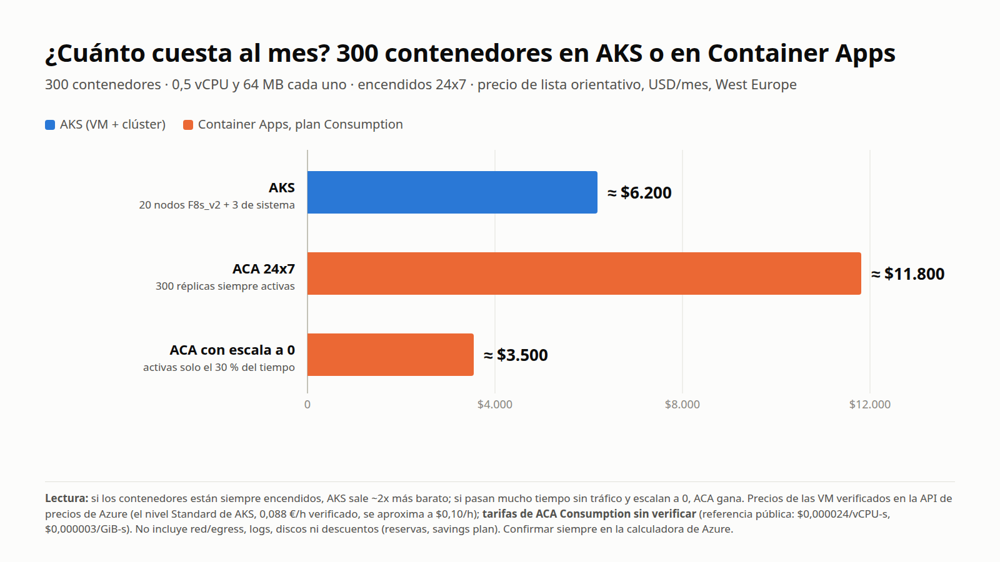
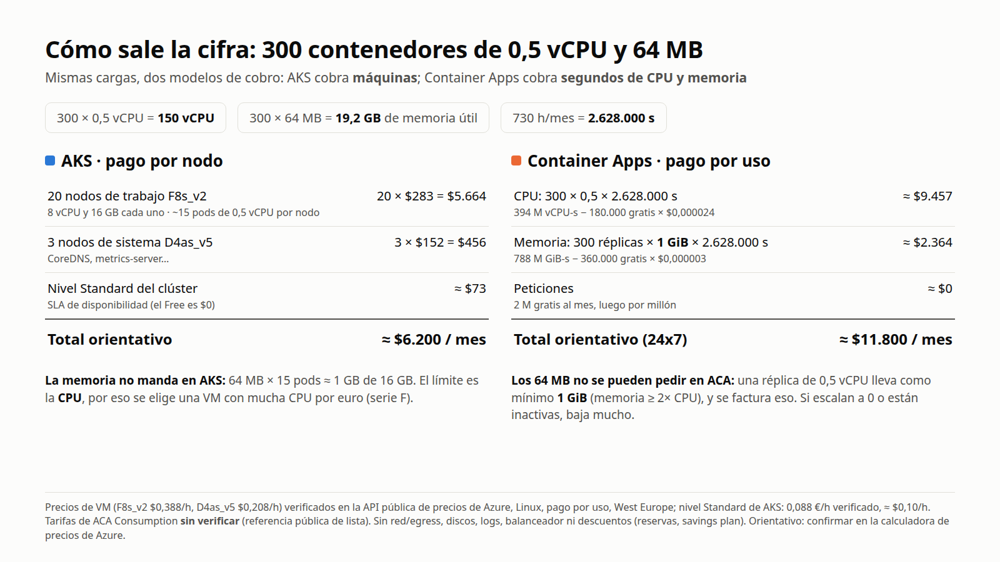

# Coste orientativo: 300 contenedores en AKS o en Container Apps

Pregunta del día 29/10/2026: migrar de on-prem 300 contenedores de **0,5 vCPU y 64 MB** cada uno. ¿Cuánto cuesta al mes en AKS y en ACA? Resultado orientativo, no una oferta: **confirmar siempre en la [calculadora de precios de Azure](https://azure.microsoft.com/en-us/pricing/calculator/)**.

## Datos de partida
- 300 × 0,5 vCPU = **150 vCPU**; 300 × 64 MB = **19,2 GB**. Mes de 730 h = 2.628.000 s. Región West Europe, Linux, pago por uso, USD.
- Fuente de precios de VM y AKS: API pública `https://prices.azure.com/api/retail/prices` (consultada el 29/10/2026): F8s_v2 $0,388/h (0,3414 €/h), D4as_v5 $0,208/h (0,183 €/h), AKS nivel Standard 0,088 €/h (≈ $0,10/h), nivel Free $0.

## AKS (pago por nodo)
| Concepto | Cálculo | USD/mes |
|---|---|---|
| 20 nodos de trabajo F8s_v2 (8 vCPU, 16 GB) | ~15 pods de 0,5 vCPU por nodo (allocatable ≈ 7,5 vCPU) → 300/15 = 20 | ≈ 5.664 |
| 3 nodos de sistema D4as_v5 | | ≈ 456 |
| Nivel Standard del clúster | 0,088 €/h × 730 | ≈ 73 |
| **Total** | | **≈ 6.200** |

La memoria no limita (64 MB × 15 pods ≈ 1 GB de 16 GB); manda la CPU, así que se elige VM con mucha CPU por precio (serie F). Hay que dejar margen para actualizaciones y alta disponibilidad (+10-20 %).

## Container Apps, plan Consumption (pago por uso)
- Una réplica de 0,5 vCPU no puede pedir 64 MB: la combinación mínima es **0,5 vCPU + 1 GiB** (memoria ≥ 2× CPU) y se factura eso → 300 GiB.
- CPU: 394 M vCPU-s − 180.000 gratis ≈ 394 M × $0,000024 ≈ **$9.457**. Memoria: 788 M GiB-s − 360.000 gratis × $0,000003 ≈ **$2.364**. **Total 24x7 ≈ $11.800.**
- Si las réplicas están activas solo el ~30 % del tiempo y escalan a 0 el resto: **≈ $3.500**.

## Conclusión
- Servicios **siempre encendidos y estables**: AKS sale ~2x más barato (y con reservas de 1 o 3 años baja aún más).
- Servicios **con picos o tiempos muertos**, escalado a 0: ACA puede ganar con claridad.
- ACA tiene además el plan **Dedicated** (workload profiles, se paga por VM), más parecido a AKS en coste; no se ha calculado aquí.
- Sin incluir: red/egress, discos, logs de Azure Monitor, balanceador, ni descuentos. 300 contenedores reales de 64 MB suelen consumir mucho menos que 0,5 vCPU: afinar los `requests` (p. ej. 0,1-0,25) cambia el resultado más que elegir servicio.

## Qué no está verificado
Las tarifas de ACA Consumption ($0,000024 por vCPU-s y $0,000003 por GiB-s) son la referencia pública que conozco, **no** las he podido confirmar: la API de precios solo devuelve el tramo gratuito de esos medidores y la página de precios carga con JavaScript. El número de pods por nodo (~15) es una estimación.
